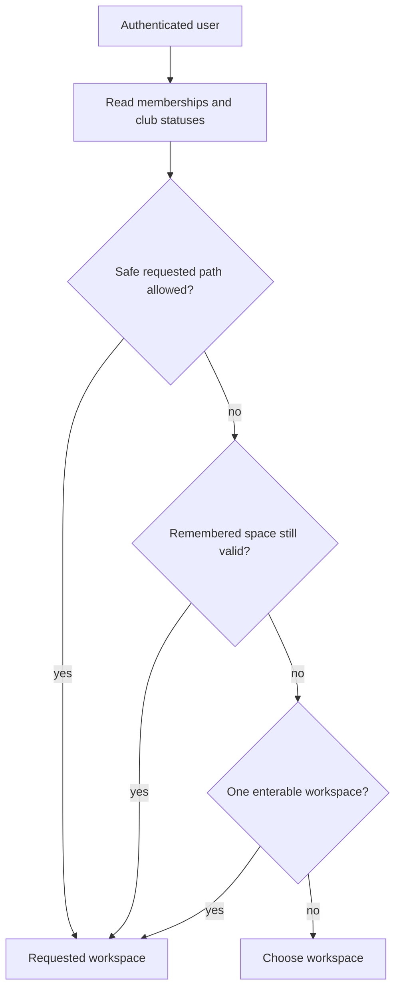

# Authorization architecture

Authorization will use server-side role-based access control for students, club
administrators, and super administrators. Each protected operation must verify the
authenticated identity and resource-level permissions on the server. Hiding a button
or route in the frontend is never sufficient authorization.

Policy decisions should be centralized, tested, and auditable. This document does not
implement roles or permissions.

Super-admin user management re-checks `SUPER_ADMIN` in the page and service layer.
Only `STUDENT` and `SUPER_ADMIN` are assignable as global roles; club-admin access
remains an approved per-club membership. Suspension changes the persisted user
status and is checked by the authentication callbacks before a session is accepted.

## Space switching

The role-aware space resolver treats `ClubMembership` as the source of truth:
active `CLUB_ADMIN` membership is required for `/club-admin/[slug]`, approved
membership is required for member views, and pending or suspended memberships are
displayed without an enterable link. Space identifiers and requested paths are
validated server-side; the remembered-space cookie never grants access.

