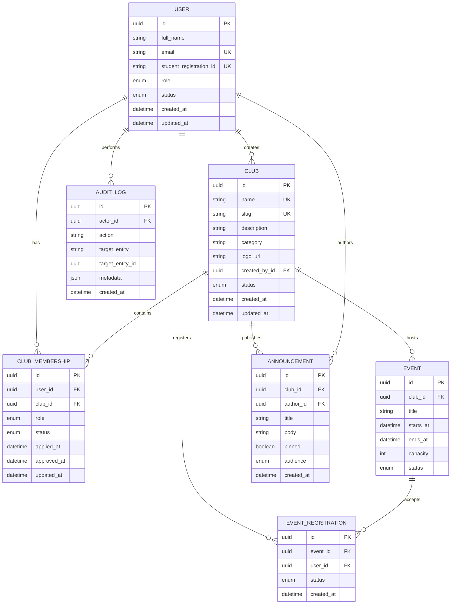

# ClubsHub entity relationship

The diagram covers the Stage 02 implemented schema. Authentication identities and
future modules are intentionally omitted.

`USER` to `CLUB` membership is many-to-many through `CLUB_MEMBERSHIP`, with a
database-enforced unique `(user_id, club_id)` pair. `AUDIT_LOG.actor_id` is nullable
and uses `SET NULL` so historical records remain available if an account is removed.
